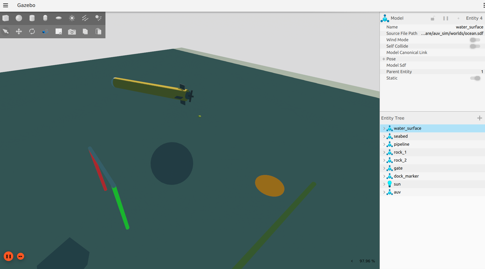
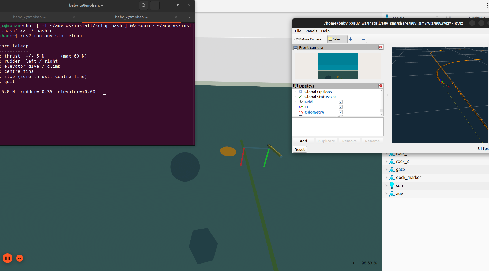

# AUV simulation (ROS 2 Humble + Gazebo Fortress)



*Torpedo AUV in the ocean world. On the seabed: the red/green gate, rocks, the dock marker and the pipeline.*



*Driving with keyboard teleop. RViz shows the odometry trail and the live front-camera feed.*

Tested on Ubuntu 22.04, ROS 2 Humble, Ignition Gazebo Fortress 6.16, ros_gz 0.244.

## Build

```bash
cd ~/auv_ws
source /opt/ros/humble/setup.bash
rosdep install --from-paths src --ignore-src -y
colcon build --symlink-install
source install/setup.bash
```

## Run

```bash
# Terminal 1 – simulator + bridge (+ RViz)
ros2 launch auv_sim sim.launch.py rviz:=true

# Terminal 2a – drive it by keyboard
ros2 run auv_sim teleop

# …or 2b – closed-loop depth/heading autopilot
ros2 run auv_sim autopilot --ros-args -p target_depth:=5.0 -p target_heading_deg:=0.0 -p thrust:=20.0 -p use_sim_time:=true
ros2 topic pub --once /auv/setpoint/depth   std_msgs/msg/Float64 "{data: 10.0}"
ros2 topic pub --once /auv/setpoint/heading std_msgs/msg/Float64 "{data: 90.0}"
```

Run only one of teleop / autopilot at a time, because both publish the actuator topics.

Launch args: `gui:=false` (headless), `rviz:=true`, `x y z yaw` (spawn pose, default z=-3).

Plot data: `ros2 run plotjuggler plotjuggler`. Camera: `ros2 run rqt_image_view rqt_image_view /auv/camera/image`.

## ROS interface

| Topic | Type | Dir | Notes |
|---|---|---|---|
| `/auv/thrust` | std_msgs/Float64 | in | N, +ve forward, ±60 |
| `/auv/rudder` | std_msgs/Float64 | in | rad, +ve = turn right, ±0.35 |
| `/auv/elevator` | std_msgs/Float64 | in | rad, −ve = dive, ±0.35 |
| `/auv/odom` | nav_msgs/Odometry | out | ground truth, 50 Hz, `odom → base_link` |
| `/auv/imu` | sensor_msgs/Imu | out | 100 Hz, with noise |
| `/auv/depth` | std_msgs/Float64 | out | m, +ve down, σ = 2 cm |
| `/auv/camera/image`, `/camera_info` | sensor_msgs | out | 640×480 @ 15 Hz, nose camera |
| `/auv/joint_states` | sensor_msgs/JointState | out | propeller / rudder / elevator |
| `/tf`, `/clock` | | out | |

Frames: ENU, `+x` nose, `+z` up. Pitch > 0 = nose down.

## World (`worlds/ocean.sdf`)

Water surface at z = 0 (graded buoyancy, so the AUV can surface), sandy seabed at z = −20 m,
a red/green gate at (20, 0, −5), a pipeline along y = −4 on the seabed, rocks, and a dock marker at (40, 0).

## Vehicle (`models/auv/model.sdf`)

1.6 m × 0.2 m torpedo, 50.1 kg, about 0.14 kg positively buoyant. Gazebo plugins: Thruster,
JointPositionController ×2, LiftDrag ×2, Hydrodynamics (added mass + linear/quadratic damping),
IMU, camera, OdometryPublisher, JointStatePublisher.

### Fortress gotchas already handled in the model
- **Graded buoyancy ignores cylinders**, so the hull collision is a box of equal volume.
- **The Hydrodynamics Coriolis term couples pitch into yaw**, so `disable_coriolis` is set.
- **Fins stick when driven into their joint limit** in velocity mode, so the limits are ±0.5 rad
  while commands are clamped to ±0.35.
- There is no DVL or pressure sensor in Fortress. Depth is ground truth plus noise (`depth_sensor` node).

## Credits

- The fin lift/drag coefficients and propeller thrust coefficient are taken from the
  `auv_controls.sdf` example (MBARI Tethys) shipped with Gazebo Fortress (Apache-2.0).
- The hydrodynamic model follows Fossen, *Guidance and Control of Ocean Vehicles*, as implemented
  by Gazebo's Hydrodynamics system.

## Package layout

```
src/auv_sim/
  auv_sim/   teleop.py  autopilot.py  depth_sensor.py
  config/    bridge.yaml          # ROS <-> Gazebo topic mapping
  launch/    sim.launch.py
  models/auv/model.sdf
  rviz/      auv.rviz
  worlds/    ocean.sdf
```
